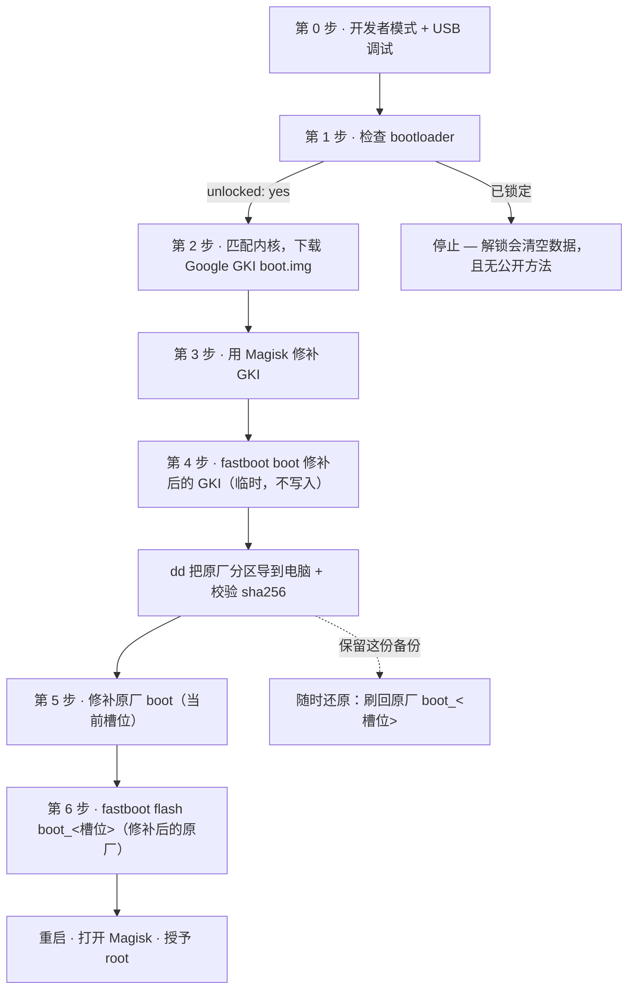

# INMO Air3 Root 教程（Magisk，不清空数据）

[English](README.md) · **简体中文**

用「临时启动」的方式给 **INMO Air3（型号 IMA301）** AR 眼镜获取 Magisk root。
关键点：在刷写任何分区**之前**先把原厂 `boot` 镜像备份下来。不清空 `userdata`、
不装第三方 recovery，并且一条命令就能刷回原厂。



> **本机状态说明。** 本教程所用的那台眼镜，bootloader **本来就是解锁的**
> （`fastboot getvar unlocked` → `yes`），`fastboot oem device-info` 也显示已解锁，
> 且高通安全启动是**关闭**的（`secure: no`）。你的机器可能不同——先自行检查
> （见[第 1 步](#第-1-步--检查你的设备)）。如果你的 bootloader 已锁且无法解锁，
> 本方法不适用。

> ⚠️ **动手前务必读。** 修改 `boot` 本身有风险。INMO 不提供完整固件，所以
> [第 4 步](#第-4-步--备份原厂分区)做的那份可靠分区备份，是你刷坏后唯一的退路，
> **不要跳过**。一切后果自负，可能导致保修失效。

---

## 为什么要「临时启动」？

在 `user` 版系统上，没 root 之前 `fastboot fetch` 和 ADB 里的 `dd` 都读不出 boot
分区，而 INMO 又没有可供提取原厂 `boot.img` 的固件包。绕过办法：

1. 用 **Google GKI** boot 镜像（内核和眼镜匹配）配合 Magisk 修补。
2. `fastboot boot` **临时**启动它——不往设备写任何东西。
3. 在这个临时 root 的会话里，用 `dd` 把真正的原厂分区导出到电脑。**这时你就有备份了。**
4. 再用 Magisk 修补**原厂** `boot`，只刷这一个。

[第 6 步](#第-6-步--刷入-magisk-修补的原厂-boot)刷写之前的每一步都是只读或内存里的操作。

---

## 你需要准备

- 眼镜已打开**开发者模式 + USB 调试**（见
  [第 0 步](#第-0-步--在眼镜上开启开发者模式usb-调试与-adb)）。
- 一台 Windows 或 Linux 电脑，装好 **[Android platform-tools][pt]**（`adb`、`fastboot`）。
- Google 的 **USB 驱动**（Windows），让电脑在 bootloader/fastbootd 模式下能认到眼镜。
  见 [Windows USB 驱动](scripts/windows/README.md)。
- 眼镜的 USB-C 数据线。
- 你自己从官方渠道下载的文件（见 [下载](#下载)）——**本仓库不附带任何二进制文件。**

[pt]: https://developer.android.com/tools/releases/platform-tools

---

## 下载（请自行获取）

| 文件 | 来源 | 说明 |
|---|---|---|
| Google GKI boot 镜像 | [Android GKI release builds][gki] | 选内核和你眼镜匹配的那一版（见第 2 步）。 |
| Magisk APK | [Magisk releases][magisk] | 只用官方 `topjohnwu/Magisk`。 |

下载的东西都要校验。Google GKI 镜像和 Magisk APK 都由发布者签名，别用镜像站。

[gki]: https://source.android.com/docs/core/architecture/kernel/gki-release-builds
[magisk]: https://github.com/topjohnwu/Magisk/releases

---

## 步骤

### 第 0 步 — 在眼镜上开启开发者模式、USB 调试与 ADB

必须**先**在眼镜上打开开发者模式并授权 ADB，后面每一步都靠 `adb`/`fastboot`
跟眼镜通信。

INMO 的眼镜进开发者模式的方式有点非标准。官方只给出了 **Air2** 的确切手势
（设置 → 关于 → *我的眼镜*，然后在右侧镜腿触控板上长按两次、每次约 1.5 秒，
输入密码 `20210108`）。Air3 是 Android 14，所以**先试标准安卓方式**，如果你的
系统把版本号入口藏起来了，再退回用 Air2 的手势：

1. 在眼镜上打开 **设置 → 关于本机 / 关于设备**（INMO 可能叫*我的眼镜*）。
2. **连续点击版本号 7 次**，直到提示*你已成为开发者*。
   - 如果没有可点的版本号，就用 INMO 的入口：在"关于"界面
     **长按右触控板两次（每次约 1.5 秒）**，输入 **`20210108`**。
3. 回到 **设置 → 系统 → 开发者选项**，打开 **USB 调试**
   （如果单独列出 *ADB 调试* 也一并打开）。
4. 用 USB-C 把眼镜连到电脑。USB 模式选 **文件传输 (MTP)**，不要选仅充电。
5. 眼镜上弹出 **"允许 USB 调试？"** 时，勾选*始终允许此电脑*并点**允许**。
   （如果一直不弹，在电脑上运行一次 `adb devices` 就会触发。）

> INMO 提示：开启 ADB 可能使短期无理由退货失效，改动系统也可能导致不稳定——
> 这些风险由你自己承担。

在电脑上验证：

```sh
adb devices          # 眼镜应显示为 'device'，而不是 'unauthorized'
```

若显示 `unauthorized`，去眼镜上点允许；若列表为空，检查数据线/USB 模式，
以及 USB 调试是否已打开。

### 第 1 步 — 检查你的设备

确认 ADB 可用后（第 0 步），检查 bootloader 状态：

```sh
adb devices
adb reboot bootloader
fastboot getvar unlocked          # 期望：unlocked: yes
fastboot oem device-info          # 期望：Device unlocked: true
fastboot getvar secure            # 记下这个值
```

如果 `unlocked` 不是 `yes`，停下——你得先解锁 bootloader（这**会**清空数据），
而本设备目前没有公开的解锁方法。

做完用 `fastboot reboot` 重启回系统。

### 第 2 步 — 匹配内核并获取 GKI boot 镜像

```sh
adb shell uname -r
```

读出 `android<N>-<x.y>.<子版本>` 这个内核字符串，然后从
[GKI release builds][gki] 页面下载匹配的 Google GKI boot 镜像
（用认证 GKI 构件里的 `boot-<版本>.img`，arm64）。

### 第 3 步 — 用 Magisk 修补 GKI 镜像（临时启动用）

用 Magisk 应用的 *修补文件* 功能修补 GKI 的 `boot.img`，**或者**用仓库里的
[`scripts/device/patch_boot.sh`](scripts/device/patch_boot.sh)，它在
`/data/local/tmp` 下用 Magisk 自带的 `boot_patch.sh` 在设备上修补。
修补后镜像的 OS 补丁级别要和源一致——不要调高。

### 第 4 步 — 备份原厂分区

`fastboot boot` 启动**修补后的 GKI** 镜像（临时，不写入任何分区），然后在这个
root 会话里把原厂分区导到电脑并校验哈希。
[`scripts/device/dump_partitions.sh`](scripts/device/dump_partitions.sh) 会把
**两个槽位**的 `boot`、`vendor_boot`、`vbmeta`、`vbmeta_system`、`dtbo`、
`recovery` 都导出，并生成 `sha256` 列表。拉回电脑后逐个核对。

**把这份备份存到安全的地方（留两份）。** 它是设备专属的，是你唯一的退路。

### 第 5 步 — 修补原厂 boot

对你**当前槽位**的原厂 `boot` 镜像跑一次 Magisk 修补
（用 `fastboot getvar current-slot` 查当前槽位）。仓库里的脚本默认用当前槽位
——永远不要假设槽位，要读出来。

### 第 6 步 — 刷入 Magisk 修补的原厂 boot

```sh
adb reboot bootloader
fastboot flash boot_<槽位> magisk_patched_boot.img   # 只刷当前槽位
fastboot reboot
```

打开 Magisk，完成设置并授予 root（如果要用 `adb shell su`，把
**超级用户访问权限** 设为 **应用和 ADB**）。

### 还原到原厂

```sh
adb reboot bootloader
fastboot flash boot_<槽位> stock_boot_<槽位>.img     # 用第 4 步的备份
fastboot reboot
```

如果系统起不来，先在 Magisk 里移除所有模块。

---

## Windows USB 驱动

在 bootloader/fastbootd 模式下，眼镜会以 Google 设备的身份出现。如果
`fastboot devices` 是空的，装上 Google 的 USB 驱动，并在设备管理器里把
**Android Bootloader Interface** 绑定到该设备。见
[`scripts/windows/README.md`](scripts/windows/README.md)。

---

## 可选：把谷歌应用装成系统特权应用

把 GSF / Play 服务 / Play 商店当普通用户应用装，在这个系统上会失败——Play 服务
需要只授予系统 `priv-app` 的特权权限（如 `MANAGE_USERS`）。
[`module/`](module) 目录里有个生成器，可以生成一个 Magisk 模块，把它们放到
`/system/priv-app` 下并附上 `privapp-permissions` 白名单。APK 由你自己提供，
本仓库不附带。见 [`module/README.md`](module/README.md)。

---

## 许可

MIT —— 见 [LICENSE](LICENSE)。按原样提供，不含任何担保。「INMO」和「Air3」是
各自所有者的商标；本项目与其无关联。
